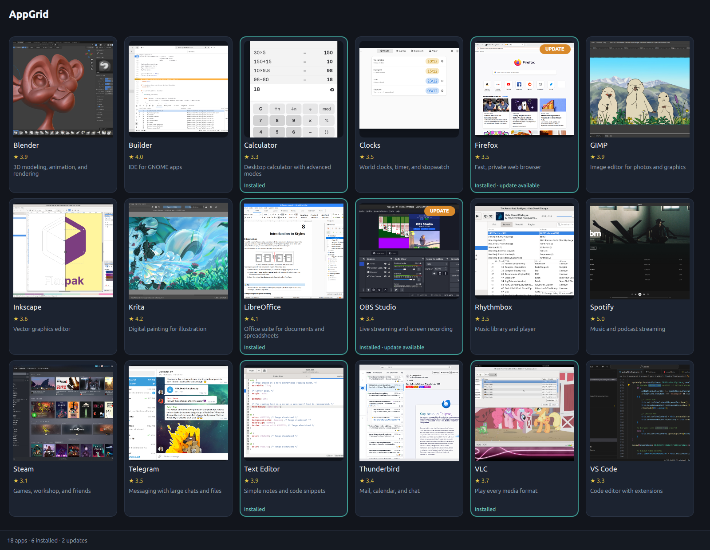
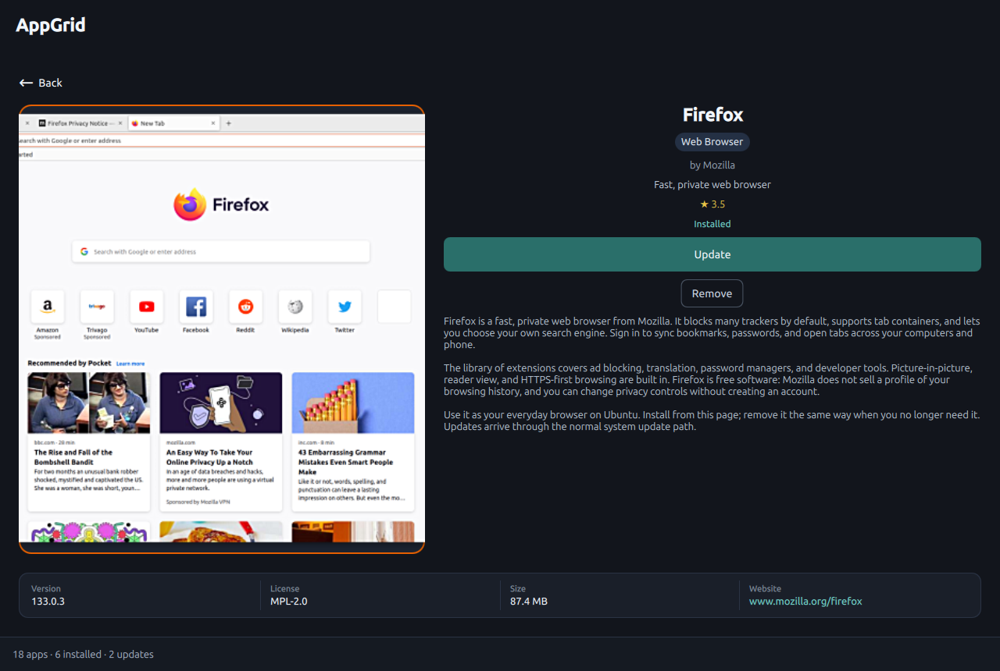

# AppGrid

AppGrid is a lightweight Qt 6 software store for Debian-family desktops. Its job is simple: help you **find an app, decide it’s the one you want, and install it** — without turning into another full desktop “Software” app.

You browse desktop applications as a **screenshot grid**. Each tile shows a real AppStream screenshot when one exists (with icon fallback), a short summary, and a star rating when ODRS data is available. Open a card for more detail, then install, remove, or update from there. System-wide updates are one click too.





## Why AppGrid exists

Most Linux software UIs fall into two camps. Distro stores (GNOME Software, KDE Discover, Ubuntu App Center) try to be complete desktop centers — useful, but often heavy, slow on first load, or steered toward snaps and curated catalogs. On the other side, `apt`, Synaptic, and Flathub websites are powerful if you already know what you’re looking for, but they don’t make it easy to *see* apps the way people shop for them.

AppGrid is the middle path: a **fast visual store over the packages you already trust**. APT is the default path. Flatpak (Flathub) is optional and off until you enable it in Settings. When both are on, the same app still appears as **one card** — AppGrid picks the newer build and keeps backend labels out of the UI so you’re choosing an app, not a packaging format.

It’s a new implementation of the old App Grid idea (screenshot tiles from existing sources), not a revival of the Launchpad PPA codebase, and not an attempt at DE chrome parity. The product bet is browse-and-install speed, not matching every GNOME or KDE Software feature.

## Who it’s for

AppGrid is for people on **Ubuntu 24.04 LTS**, **Debian 12**, and closely related systems — **Linux Mint 22**, elementary OS 8, Pop!_OS 24.04, Zorin when it’s 24.04-based, and similar. If your day-to-day install path is `.deb` / APT and you sometimes want Flathub without living in a Flatpak-only browser, this is aimed at you.

It’s especially useful if you prefer deciding from screenshots and short descriptions rather than package names, and if you want a store that stays out of the way once the app is installed.

It is **not** for Arch, CachyOS, Fedora, or other unrelated families. Those are rejected up front rather than half-supported.

## What you get

- Screenshot-first grid, search, **Browse by categories** (chip strip under search; Clear filter resets), Installed / Updates, and **Update system**
- Install, remove, per-app update; dual-install confirm when adding a newer copy beside an older one; **Update installed** when that still applies
- Optional Flatpak from Flathub; **one card per app** — newer build wins, without APT/Flatpak chrome in the normal UI
- PackageKit password prompt on a normal desktop session (polkit), with a one-shot PolicyKit helper if no dialog appears
- Sticky Install/fail status so errors don’t vanish; live progress percent when the backend reports it
- Updates view re-checks package indexes on a short cooldown; detail **facts** strip (version, license, size, website)
- Online `.deb`, plus offline **AppGridSetup** that vendors Qt for double-click install on Ubuntu 24.04 / Mint 22 amd64

Full history of the v1.0.0 era: [CHANGELOG.md](CHANGELOG.md).

## Install the .deb

**Current release:** [v1.0.0](https://github.com/dark1ltg/AppGrid/releases/tag/v1.0.0) — same ship as [CHANGELOG.md](CHANGELOG.md) on current `master`. Prefer the GitHub Release assets (they match `dist/`).

| Package | SHA256 |
| --- | --- |
| Online `appgrid_1.0.0-1_all.deb` | `317940414f8725740733a6cd5605d4c454139e2b6bef0544536008124f51396e` |
| Offline `AppGridSetup-1.0.0-amd64.deb` / `appgrid_1.0.0-1_amd64.deb` | `8034b76f384eb66ead4a1b5174ff14b720a10054648599dd08a53dc9097e3a27` |

**Offline installer (Ubuntu 24.04 / Mint 22 amd64):** `dist/AppGridSetup-1.0.0-amd64.deb` (same bits as `appgrid_1.0.0-1_amd64.deb`). Qt/PyQt6 live under `/opt/appgrid`, so they do **not** clash with apt’s Qt. Needs a normal desktop (Python 3, Mesa/OpenGL, GLib). Not for ARM.

Double-click the file in Files. App Center, GNOME Software, Discover, or GDebi should open with an **Install** button, then the usual administrator password prompt. That package does not pull Flatpak or extra Qt from the network.

If double-click says there is no app for Debian packages, right-click → **Open With** → App Center / Software Install / GDebi. Ubuntu 24.04 App Center needs a current `snap-store` (`snap refresh`) for local `.deb` files.

```bash
sudo dpkg -i ./dist/AppGridSetup-1.0.0-amd64.deb
```

**Online (any 24.04-family arch):** small package; apt fetches PyQt6/PySide6.

```bash
sudo apt install ./dist/appgrid_1.0.0-1_all.deb
```

## Run

```bash
python3 -m appgrid
```

Filler catalog (useful off Ubuntu, or for screenshots):

```bash
python3 -m appgrid --demo
```

Screenshot:

```bash
python3 -m appgrid --screenshot docs/ui-grid.png
```

## Ubuntu 24.04 dependencies

24.04 is the baseline. It ships **PyQt6**, not PySide6. Do not `pip install PySide6` (that wheel is the entire Qt SDK) and do not add KDE Neon for bindings.

```bash
sudo apt install python3-pyqt6 python3-pyqt6.qtqml python3-pyqt6.qtquick \
  qml6-module-qtquick qml6-module-qtquick-controls qml6-module-qtquick-layouts \
  qml6-module-qtquick-window \
  python3-gi gir1.2-appstream-1.0 libqt6svg6 \
  packagekit pkexec
# Ubuntu 24.04 / Debian 12–13 also have packagekit-tools (pkcon). Debian Sid /
# BlankOn dropped that package — PackageKit 1.4 ships pkgcli in packagekit instead.
```

On 24.10+ / Debian 13+, the `.deb` prefers split `python3-pyside6.qt*` instead. AppGrid tries PySide6 first at runtime, then PyQt6.

Optional: `flatpak` (Settings → Enable Flatpak). The `.deb` only Recommends it so OSTree/portals are not forced.

## Architecture

| Plugin | Catalog | Install / remove / update |
| --- | --- | --- |
| `apt` | AppStream package bundles + python-apt / dpkg | PackageKit (`pkcon`), then `appgrid-apt-helper` via PolicyKit |
| `flatpak` | AppStream Flatpak bundles + libflatpak | `flatpak install/uninstall/update` from **Flathub** (`flathub` remote; added if missing) |

On Ubuntu/Debian-family systems the app list loads in the background so the window stays responsive. Flatpak apps are tracked in both the user and system installs. Other distributions are rejected with an on-screen message.

## License

BSD-2-Clause. See `LICENSE`. Changes: [CHANGELOG.md](CHANGELOG.md).
